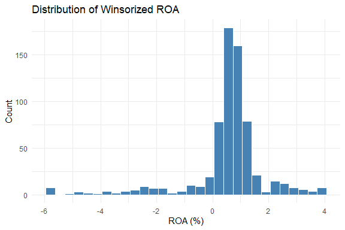

Commercial Bank Financial Performance Analysis (`bank_fa`)
================
Wasif Hoq
2026-11-08

- [1. Project Overview & Research
  Framework](#1-project-overview--research-framework)
- [2. Stage 1: Data Loading & Panel Inspection
  (`load_inspect.R`)](#2-stage-1-data-loading--panel-inspection-load_inspectr)
  - [2.1 Load Libraries](#21-load-libraries)
  - [2.2 Data Ingestion & Initial
    Glimpse](#22-data-ingestion--initial-glimpse)
  - [2.3 Data Type Validity &
    Transformation](#23-data-type-validity--transformation)
  - [2.4 Summary Statistics & Missing Values
    Audit](#24-summary-statistics--missing-values-audit)
  - [2.5 Cross-Sectional and Time Series
    Representation](#25-cross-sectional-and-time-series-representation)
  - [2.6 Panel Uniqueness
    Verification](#26-panel-uniqueness-verification)
  - [2.7 Initial Panel Structure
    Declaration](#27-initial-panel-structure-declaration)
- [3. Stage 2: Exploratory Data Analysis & Sample Preparation
  (`explore_data.R`)](#3-stage-2-exploratory-data-analysis--sample-preparation-explore_datar)
  - [3.1 Accounting Identity
    Verification](#31-accounting-identity-verification)
  - [3.2 Outlier Detection &
    Assessment](#32-outlier-detection--assessment)
  - [3.3 Sample Window Restriction
    (2013–2025)](#33-sample-window-restriction-20132025)
  - [3.4 Winsorization (1st and 99th
    Percentiles)](#34-winsorization-1st-and-99th-percentiles)
  - [3.5 Final Cleaned Panel
    Declaration](#35-final-cleaned-panel-declaration)
  - [3.6 Summary Statistics of Modeling
    Variables](#36-summary-statistics-of-modeling-variables)
  - [3.7 Visualizing Key Empirical
    Relationships](#37-visualizing-key-empirical-relationships)
  - [3.8 Cross-Sectional Institution
    Ranking](#38-cross-sectional-institution-ranking)
  - [3.9 Correlation Matrix & Multicollinearity
    Diagnostics](#39-correlation-matrix--multicollinearity-diagnostics)
  - [3.10 Export Cleaned Modeling
    Sample](#310-export-cleaned-modeling-sample)
- [4. Variable Reference Guide](#4-variable-reference-guide)
- [5. Transition to Econometric
  Modeling](#5-transition-to-econometric-modeling)

# 1. Project Overview & Research Framework

This study investigates the financial determinants of commercial bank
performance, credit risk, solvency, and operational efficiency in
Bangladesh using panel econometric techniques.

The analysis is conducted through a structured R pipeline: 1.
**`scripts/load_inspect.R`**: Raw data ingestion, data type formatting,
health checks, and initial panel validation. 2.
**`scripts/explore_data.R`**: Outlier detection, sample filtering
(2013–2025), 1st/99th percentile winsorization, exploratory
visualization, and correlation analysis. 3.
**`scripts/data_modeling.R`**: Econometric panel modeling (Pooled OLS,
Fixed Effects, and Random Effects).

------------------------------------------------------------------------

# 2. Stage 1: Data Loading & Panel Inspection (`load_inspect.R`)

### 2.1 Load Libraries

We load `tidyverse` for data manipulation, piping, and visualization,
and `plm` for panel econometrics.

``` r
library(tidyverse)
library(plm)
```

------------------------------------------------------------------------

### 2.2 Data Ingestion & Initial Glimpse

Load the processed dataset from Mendeley Data and inspect the column
names and initial observations.

``` r
raw <- read_csv("data/processed_BD_Banks_features_final.csv")
glimpse(raw)
```

    ## Rows: 780
    ## Columns: 25
    ## $ bank              <chr> "AB Bank PLC", "AB Bank PLC", "AB Bank PLC", "AB Ban…
    ## $ year              <dbl> 2008, 2009, 2010, 2011, 2012, 2013, 2014, 2015, 2016…
    ## $ basis             <chr> "solo", "solo", "solo", "solo", "solo", "solo", "sol…
    ## $ unit              <chr> "BDT million", "BDT million", "BDT million", "BDT mi…
    ## $ total_assets      <dbl> 94500, 112600, 132988, 158600, 184200, 211800, 25130…
    ## $ total_loans       <dbl> 61200, 72500, 88299, 106300, 125100, 142500, 168900,…
    ## $ deposits          <dbl> 78300, 91400, 95702, 115200, 134800, 154600, 181400,…
    ## $ equity            <dbl> 8900, 10800, 13867, 15800, 17900, 19300, 20800, 2210…
    ## $ net_income        <dbl> 2150, 2940, 3696, 2120, 1650, 1210, 1480, 1420, 1510…
    ## $ npl_ratio_pct     <dbl> 3.40, 3.10, 3.20, 3.80, 4.10, 4.60, 4.90, 5.80, 6.50…
    ## $ car_crar_pct      <dbl> 11.90, 13.20, 13.10, 12.60, 12.10, 11.90, 11.50, 11.…
    ## $ roa               <dbl> 2.2751, 2.6110, 2.7792, 1.3367, 0.8958, 0.5713, 0.58…
    ## $ roe               <dbl> 24.1573, 27.2222, 26.6532, 13.4177, 9.2179, 6.2694, …
    ## $ ldr               <dbl> 78.1609, 79.3217, 92.2645, 92.2743, 92.8042, 92.1734…
    ## $ loan_to_assets    <dbl> 64.7619, 64.3872, 66.3962, 67.0240, 67.9153, 67.2805…
    ## $ deposit_to_assets <dbl> 82.8571, 81.1723, 71.9629, 72.6356, 73.1813, 72.9934…
    ## $ equity_to_assets  <dbl> 9.4180, 9.5915, 10.4273, 9.9622, 9.7177, 9.1124, 8.2…
    ## $ size_ln_assets    <dbl> 11.4564, 11.6316, 11.7980, 11.9741, 12.1238, 12.2634…
    ## $ car_surplus       <dbl> 1.90, 3.20, 3.10, 2.60, 2.10, 1.90, 1.50, 1.80, 1.40…
    ## $ asset_growth      <dbl> 11.7225, 19.1534, 18.1066, 19.2589, 16.1412, 14.9837…
    ## $ loan_growth       <dbl> 12.3133, 18.4641, 21.7917, 20.3864, 17.6858, 13.9089…
    ## $ deposit_growth    <dbl> 11.2417, 16.7305, 4.7068, 20.3737, 17.0139, 14.6884,…
    ## $ profit_growth     <dbl> 10.3572, 36.7442, 25.7143, -42.6407, -22.1698, -26.6…
    ## $ zscore            <dbl> 12.4565, 12.9991, 14.0686, 12.0365, 11.3063, 10.3158…
    ## $ ln_zscore         <dbl> 2.5222, 2.5649, 2.6439, 2.4879, 2.4254, 2.3337, 2.24…

- **Observations**: 780 rows across 57 commercial banks.
- **Reporting Period**: Historical records span 1996 to 2025.

------------------------------------------------------------------------

### 2.3 Data Type Validity & Transformation

Panel econometrics requires explicit cross-sectional ($i$) and temporal
($t$) indexes. We cast `bank` into a categorical factor and `year` into
an integer:

``` r
# Data type validity check
df <- raw |>
  mutate(bank = as.factor(bank),
         year = as.integer(year))
```

------------------------------------------------------------------------

### 2.4 Summary Statistics & Missing Values Audit

Evaluate initial distributions and check whether missing observations
occur across key variables.

``` r
summary(df)
```

    ##                          bank          year            basis    
    ##  Al-Arafah Islami Bank PLC : 29   Min.   :1997   Length   :780  
    ##  EXIM Bank PLC             : 25   1st Qu.:2014   N.unique :  1  
    ##  United Commercial Bank PLC: 24   Median :2018   N.blank  :  0  
    ##  Prime Bank PLC            : 23   Mean   :2018   Min.nchar:  4  
    ##  Bank Asia                 : 21   3rd Qu.:2022   Max.nchar:  4  
    ##  Eastern Bank PLC          : 19   Max.   :2025                  
    ##  (Other)                   :639                                 
    ##         unit      total_assets        total_loans           deposits        
    ##  Length   :780   Min.   :2.552e+01   Min.   :3.440e+00   Min.   :3.000e-02  
    ##  N.unique :  1   1st Qu.:6.966e+04   1st Qu.:4.755e+04   1st Qu.:5.586e+04  
    ##  N.blank  :  0   Median :2.052e+05   Median :1.456e+05   Median :1.565e+05  
    ##  Min.nchar: 11   Mean   :2.854e+05   Mean   :1.932e+05   Mean   :2.215e+05  
    ##  Max.nchar: 11   3rd Qu.:3.713e+05   3rd Qu.:2.664e+05   3rd Qu.:2.851e+05  
    ##                  Max.   :2.391e+06   Max.   :1.849e+06   Max.   :1.796e+06  
    ##                                                                             
    ##      equity          net_income        npl_ratio_pct     car_crar_pct    
    ##  Min.   :-250171   Min.   :-261420.0   Min.   : 0.040   Min.   :-405.31  
    ##  1st Qu.:   6523   1st Qu.:    450.0   1st Qu.: 3.115   1st Qu.:  10.85  
    ##  Median :  15100   Median :   1350.0   Median : 4.500   Median :  12.42  
    ##  Mean   :  17879   Mean   :    895.6   Mean   : 9.457   Mean   :  11.16  
    ##  3rd Qu.:  23973   3rd Qu.:   2410.0   3rd Qu.: 6.250   3rd Qu.:  14.80  
    ##  Max.   :1088997   Max.   :  13450.0   Max.   :97.800   Max.   : 319.55  
    ##                                                                          
    ##       roa                roe                ldr            loan_to_assets   
    ##  Min.   :-87.1922   Min.   :-536.908   Min.   :   0.0152   Min.   : 0.0143  
    ##  1st Qu.:  0.4525   1st Qu.:   7.007   1st Qu.:  78.9158   1st Qu.:61.6976  
    ##  Median :  0.7774   Median :   9.591   Median :  90.0622   Median :68.9815  
    ##  Mean   :  0.4468   Mean   :   8.212   Mean   : 101.1557   Mean   :65.9335  
    ##  3rd Qu.:  1.1658   3rd Qu.:  13.629   3rd Qu.:  96.6445   3rd Qu.:75.3822  
    ##  Max.   :  7.2381   Max.   :  42.914   Max.   :1481.5261   Max.   :97.3367  
    ##                                                                             
    ##  deposit_to_assets  equity_to_assets   size_ln_assets   car_surplus      
    ##  Min.   :  0.0006   Min.   :-149.464   Min.   : 3.24   Min.   :-415.310  
    ##  1st Qu.: 72.3480   1st Qu.:   5.964   1st Qu.:11.15   1st Qu.:   0.900  
    ##  Median : 77.3126   Median :   7.630   Median :12.23   Median :   2.420  
    ##  Mean   : 75.4117   Mean   :   8.811   Mean   :11.91   Mean   :   1.162  
    ##  3rd Qu.: 81.0726   3rd Qu.:  10.106   3rd Qu.:12.82   3rd Qu.:   4.805  
    ##  Max.   :125.1353   Max.   : 807.168   Max.   :14.69   Max.   : 309.550  
    ##                                                                          
    ##   asset_growth        loan_growth       deposit_growth      
    ##  Min.   :  -71.086   Min.   : -59.479   Min.   :     -78.9  
    ##  1st Qu.:    8.112   1st Qu.:   7.898   1st Qu.:       7.8  
    ##  Median :   11.723   Median :  12.313   Median :      11.2  
    ##  Mean   :   38.931   Mean   :  35.081   Mean   :   18876.1  
    ##  3rd Qu.:   17.339   3rd Qu.:  18.149   3rd Qu.:      16.6  
    ##  Max.   :16882.837   Max.   :6207.031   Max.   :14691433.3  
    ##                                                             
    ##  profit_growth            zscore          ln_zscore     
    ##  Min.   :-16946.667   Min.   :-136.52   Min.   :-1.521  
    ##  1st Qu.:    -4.131   1st Qu.:  11.62   1st Qu.: 2.619  
    ##  Median :    10.357   Median :  20.59   Median : 3.109  
    ##  Mean   :    37.485   Mean   :  35.22   Mean   : 3.091  
    ##  3rd Qu.:    22.518   3rd Qu.:  37.76   3rd Qu.: 3.631  
    ##  Max.   : 55960.000   Max.   :3087.78   Max.   : 8.035  
    ## 

``` r
# Check missing values count per variable
colSums(is.na(df))
```

    ##              bank              year             basis              unit 
    ##                 0                 0                 0                 0 
    ##      total_assets       total_loans          deposits            equity 
    ##                 0                 0                 0                 0 
    ##        net_income     npl_ratio_pct      car_crar_pct               roa 
    ##                 0                 0                 0                 0 
    ##               roe               ldr    loan_to_assets deposit_to_assets 
    ##                 0                 0                 0                 0 
    ##  equity_to_assets    size_ln_assets       car_surplus      asset_growth 
    ##                 0                 0                 0                 0 
    ##       loan_growth    deposit_growth     profit_growth            zscore 
    ##                 0                 0                 0                 0 
    ##         ln_zscore 
    ##                 0

------------------------------------------------------------------------

### 2.5 Cross-Sectional and Time Series Representation

We examine the number of observations available per commercial bank and
the coverage per fiscal year:

``` r
# Annual counts per commercial bank (first 15 shown)
df |> count(bank) |> print(n = 15)
```

    ## # A tibble: 57 × 2
    ##    bank                                        n
    ##    <fct>                                   <int>
    ##  1 AB Bank PLC                                18
    ##  2 Agrani Bank PLC                            12
    ##  3 Al-Arafah Islami Bank PLC                  29
    ##  4 Bangladesh Commerce Bank Limited (BCBL)     5
    ##  5 Bangladesh Development Bank PLC             7
    ##  6 Bangladesh Krishi Bank                     10
    ##  7 Bank Alfalah Limited                       13
    ##  8 Bank Asia                                  21
    ##  9 BASIC Bank PLC                             12
    ## 10 Bengal Commercial Bank PLC                  6
    ## 11 BRAC Bank PLC                               6
    ## 12 Citibank N.A                               13
    ## 13 Citizens Bank PLC                           6
    ## 14 City Bank PLC                              13
    ## 15 Community Bank Bangladesh PLC               7
    ## # ℹ 42 more rows

``` r
# Number of reporting banks per fiscal year
df |> count(year) |> print(n = 30)
```

    ## # A tibble: 29 × 2
    ##     year     n
    ##    <int> <int>
    ##  1  1997     1
    ##  2  1998     1
    ##  3  1999     1
    ##  4  2000     1
    ##  5  2001     2
    ##  6  2002     3
    ##  7  2003     4
    ##  8  2004     4
    ##  9  2005     5
    ## 10  2006     5
    ## 11  2007     8
    ## 12  2008    10
    ## 13  2009    11
    ## 14  2010    14
    ## 15  2011    17
    ## 16  2012    22
    ## 17  2013    41
    ## 18  2014    46
    ## 19  2015    48
    ## 20  2016    49
    ## 21  2017    49
    ## 22  2018    50
    ## 23  2019    55
    ## 24  2020    57
    ## 25  2021    57
    ## 26  2022    57
    ## 27  2023    57
    ## 28  2024    55
    ## 29  2025    50

*Observation*: Pre-2013 records feature fewer reporting institutions.
From 2013 onwards, reporting is dense and consistent across the banking
sector.

------------------------------------------------------------------------

### 2.6 Panel Uniqueness Verification

Verify that each bank appears at most once per fiscal year:

``` r
sum(duplicated(df[c("bank", "year")]))
```

    ## [1] 0

The count of `0` confirms the dataset satisfies the strict panel
requirement of unique $(i, t)$ tuples.

------------------------------------------------------------------------

### 2.7 Initial Panel Structure Declaration

Declare the panel dataframe index using `plm::pdata.frame`:

``` r
pdata <- pdata.frame(df, index = c("bank", "year"))
pdim(pdata)
```

    ## Unbalanced Panel: n = 57, T = 5-29, N = 780

- **Panel Type**: Unbalanced panel (entities enter at varying dates).
- **$n$ (Banks)**: 57
- **$T$ (Years per bank)**: 5 to 29 years
- **$N$ (Total observations)**: 780

------------------------------------------------------------------------

# 3. Stage 2: Exploratory Data Analysis & Sample Preparation (`explore_data.R`)

### 3.1 Accounting Identity Verification

Before running predictive regressions, we confirm accounting
relationships. Return on Assets (ROA) is defined as:

$$\text{ROA} = \frac{\text{Net Income}}{\text{Total Assets}} \times 100$$

``` r
df |>
  mutate(check = net_income / total_assets * 100) |>
  select(bank, year, roa, check) |>
  head(10)
```

    ## # A tibble: 10 × 4
    ##    bank         year   roa check
    ##    <fct>       <int> <dbl> <dbl>
    ##  1 AB Bank PLC  2008 2.28  2.28 
    ##  2 AB Bank PLC  2009 2.61  2.61 
    ##  3 AB Bank PLC  2010 2.78  2.78 
    ##  4 AB Bank PLC  2011 1.34  1.34 
    ##  5 AB Bank PLC  2012 0.896 0.896
    ##  6 AB Bank PLC  2013 0.571 0.571
    ##  7 AB Bank PLC  2014 0.589 0.589
    ##  8 AB Bank PLC  2015 0.499 0.499
    ##  9 AB Bank PLC  2016 0.480 0.480
    ## 10 AB Bank PLC  2017 0.118 0.118

Because `net_income` directly calculates `roa`, including `net_income`
as an explanatory variable in an ROA model would create severe
endogeneity and tautological bias.

------------------------------------------------------------------------

### 3.2 Outlier Detection & Assessment

Sorting by `roa` reveals severe negative values:

``` r
df |>
  arrange(roa) |>
  select(bank, year, roa, total_assets, equity, net_income) |>
  head(10)
```

    ## # A tibble: 10 × 6
    ##    bank                          year    roa total_assets    equity net_income
    ##    <fct>                        <int>  <dbl>        <dbl>     <dbl>      <dbl>
    ##  1 Union Bank PLC                2024 -87.2      299820.  -250171.   -261420  
    ##  2 Citizens Bank PLC             2020 -79.6          25.5     -20.3      -20.3
    ##  3 Bangladesh Krishi Bank        2024 -14.8      441566.  -192502.    -65134. 
    ##  4 Rajshahi Krishi Unnayan Bank  2020  -7.93       7750.     -870.      -615. 
    ##  5 BASIC Bank PLC                2016  -7.29     204740.    10808.    -14930. 
    ##  6 National Bank PLC             2022  -6.3      521446     41664     -32851  
    ##  7 Rajshahi Krishi Unnayan Bank  2021  -5.90       8214.    -1361.      -484. 
    ##  8 BASIC Bank PLC                2024  -5.82     148351.   -14541.     -8631. 
    ##  9 Bangladesh Krishi Bank        2023  -5.77     413529.  -127913.    -23848. 
    ## 10 ICB Islamic Bank PLC          2024  -5.26       9243    -13815       -486

**Key Findings:** 1. **Citizens Bank PLC (2020)**: Reported an extreme
ROA of -79.6% on reported total assets of only 25.5 BDT million. This
asset base is disproportionately tiny compared to standard commercial
banks, pointing to an unverified reporting artifact or restructuring
distortion. 2. **Union Bank PLC (2024)**: Reported an ROA of -87.2%, but
on normal-scale total assets (reflecting a verified, massive sector
shock/loss).

**Handling Strategy:** - Drop **Citizens Bank PLC (2020)** due to
unverified scale distortion. - Retain **Union Bank PLC (2024)** to
preserve real distress dynamics, treating extreme values via statistical
winsorization.

------------------------------------------------------------------------

### 3.3 Sample Window Restriction (2013–2025)

We restrict the research sample to the 2013–2025 period to ensure high
reporting density across all 57 institutions:

``` r
dfm <- df |>
  filter(year >= 2013) |>
  filter(!(bank == "Citizens Bank PLC" & year == 2020))

# Sample dimensions after filtering
nrow(dfm)
```

    ## [1] 670

``` r
n_distinct(dfm$bank)
```

    ## [1] 57

- **Sample Size ($N$)**: 670 bank-year observations.
- **Institutions ($n$)**: 57 banks.

------------------------------------------------------------------------

### 3.4 Winsorization (1st and 99th Percentiles)

To prevent regression coefficients from being distorted by extreme tail
values while preserving all observations, financial ratios are
winsorized at the 1st and 99th percentiles:

``` r
winsor <- function(x, p = 0.01) {
  q <- quantile(x, c(p, 1 - p), na.rm = TRUE)
  pmin(pmax(x, q[1]), q[2])
}

dfm <- dfm |>
  mutate(across(c(roa, npl_ratio_pct, car_crar_pct, size_ln_assets, ldr),
                winsor, .names = "{.col}_w"))

# Comparison of original vs. winsorized distributions
summary(dfm[c("roa", "roa_w", "ldr", "ldr_w")])
```

    ##       roa               roa_w              ldr                ldr_w         
    ##  Min.   :-87.1922   Min.   :-5.7828   Min.   :   0.0152   Min.   :  0.9047  
    ##  1st Qu.:  0.3518   1st Qu.: 0.3518   1st Qu.:  76.8491   1st Qu.: 76.8491  
    ##  Median :  0.6934   Median : 0.6934   Median :  89.7343   Median : 89.7343  
    ##  Mean   :  0.3942   Mean   : 0.5262   Mean   : 102.9827   Mean   : 97.9085  
    ##  3rd Qu.:  1.0316   3rd Qu.: 1.0316   3rd Qu.:  96.7730   3rd Qu.: 96.7730  
    ##  Max.   :  7.2381   Max.   : 3.8984   Max.   :1481.5261   Max.   :857.8209

------------------------------------------------------------------------

### 3.5 Final Cleaned Panel Declaration

Re-declaring the panel structure on the cleaned 2013–2025 sample:

``` r
pdatam <- pdata.frame(dfm, index = c("bank", "year"))
pdim(pdatam)
```

    ## Unbalanced Panel: n = 57, T = 5-13, N = 670

- **Cleaned Sample**: Unbalanced panel with 57 banks, 5 to 13 years each
  ($N = 670$).

------------------------------------------------------------------------

### 3.6 Summary Statistics of Modeling Variables

``` r
dfm |>
  select(roa_w, npl_ratio_pct_w, car_crar_pct_w, size_ln_assets_w, ldr_w) |>
  summary()
```

    ##      roa_w         npl_ratio_pct_w car_crar_pct_w    size_ln_assets_w
    ##  Min.   :-5.7828   Min.   : 0.50   Min.   :-130.93   Min.   : 8.40   
    ##  1st Qu.: 0.3518   1st Qu.: 3.24   1st Qu.:  11.20   1st Qu.:11.28   
    ##  Median : 0.6934   Median : 4.59   Median :  12.80   Median :12.42   
    ##  Mean   : 0.5262   Mean   :10.36   Mean   :  11.02   Mean   :12.04   
    ##  3rd Qu.: 1.0316   3rd Qu.: 6.85   3rd Qu.:  15.30   3rd Qu.:12.92   
    ##  Max.   : 3.8984   Max.   :81.31   Max.   : 131.94   Max.   :14.41   
    ##      ldr_w         
    ##  Min.   :  0.9047  
    ##  1st Qu.: 76.8491  
    ##  Median : 89.7343  
    ##  Mean   : 97.9085  
    ##  3rd Qu.: 96.7730  
    ##  Max.   :857.8209

- **Median ROA (`roa_w`)**: 0.69%
- **Median Non-Performing Loan Ratio (`npl_ratio_pct_w`)**: 4.59%
- **Median Capital Adequacy Ratio (`car_crar_pct_w`)**: 12.80%

------------------------------------------------------------------------

### 3.7 Visualizing Key Empirical Relationships

#### A. Median ROA Evolution (2013–2025)

``` r
dfm |>
  group_by(year) |>
  summarise(median_roa = median(roa_w), n_banks = n()) |>
  ggplot(aes(year, median_roa)) +
  geom_line(color = "steelblue", linewidth = 1.2) +
  geom_point(aes(size = n_banks)) +
  labs(title = "Median ROA by Year (2013–2025)",
       x = "Fiscal Year", y = "Median ROA (%)", size = "Reporting Banks") +
  theme_minimal()
```

<!-- -->

``` r
# Save figure to output directory
ggsave("output/median_roa_by_year.png", width = 7, height = 4)
```

#### B. Distribution of Winsorized ROA

``` r
ggplot(dfm, aes(roa_w)) +
  geom_histogram(bins = 30, fill = "steelblue", color = "white") +
  labs(title = "Distribution of Winsorized ROA", x = "ROA (%)", y = "Count") +
  theme_minimal()
```

<!-- -->

#### C. Profitability vs. Credit Risk (`ROA` vs. `NPL`)

``` r
ggplot(dfm, aes(npl_ratio_pct_w, roa_w)) +
  geom_point(alpha = 0.5, color = "darkblue") +
  geom_smooth(method = "lm", color = "red", se = TRUE) +
  labs(title = "Profitability (ROA) vs Credit Risk (NPL Ratio)",
       x = "Non-Performing Loan Ratio (%)", y = "ROA (%)") +
  theme_minimal()
```

<!-- -->

``` r
# Save figure to output directory
ggsave("output/roa_vs_npl.png", width = 6, height = 4)
```

------------------------------------------------------------------------

### 3.8 Cross-Sectional Institution Ranking

Ranking banks by mean profitability (`roa_w`) alongside credit risk
(`npl_ratio_pct_w`):

``` r
dfm |>
  group_by(bank) |>
  summarise(avg_roa = mean(roa_w),
            avg_npl = mean(npl_ratio_pct_w),
            years   = n()) |>
  arrange(desc(avg_roa)) |>
  print(n = 20) # Top 20 banks displayed
```

    ## # A tibble: 57 × 4
    ##    bank                                       avg_roa avg_npl years
    ##    <fct>                                        <dbl>   <dbl> <int>
    ##  1 Citibank N.A                                 3.53     1.20    13
    ##  2 Probashi Kallyan Bank                        2.70     3.86    13
    ##  3 Standard Chartered Bank Bangladesh           2.37     3.83    13
    ##  4 State Bank of India, Bangladesh Operations   2.34     2.61    13
    ##  5 HSBC Bangladesh                              1.73     2.35    13
    ##  6 Modhumoti Bank PLC                           1.27     2.32    13
    ##  7 BRAC Bank PLC                                1.21     3.09     6
    ##  8 Grameen Bank                                 1.20     2.91     5
    ##  9 City Bank PLC                                1.17     5.84    13
    ## 10 NRBC Bank PLC                                1.15     3.64    13
    ## 11 Jamuna Bank PLC                              1.09     3.88    12
    ## 12 Eastern Bank PLC                             1.08     3.06    13
    ## 13 Midland Bank PLC                             1.07     2.61    13
    ## 14 Dutch-Bangla Bank PLC                        1.04     4.75    13
    ## 15 Bank Alfalah Limited                         1.01     3.26    13
    ## 16 Uttara Bank PLC                              0.939    4.89    13
    ## 17 Prime Bank PLC                               0.877    4.85    13
    ## 18 NCC Bank PLC                                 0.843    6.02    13
    ## 19 Mutual Trust Bank PLC                        0.820    5.02    13
    ## 20 Mercantile Bank PLC                          0.758    5.04    13
    ## # ℹ 37 more rows

------------------------------------------------------------------------

### 3.9 Correlation Matrix & Multicollinearity Diagnostics

``` r
dfm |>
  select(roa_w, npl_ratio_pct_w, car_crar_pct_w, size_ln_assets_w, ldr_w) |>
  cor() |>
  round(2)
```

    ##                  roa_w npl_ratio_pct_w car_crar_pct_w size_ln_assets_w ldr_w
    ## roa_w             1.00           -0.67           0.56            -0.02  0.22
    ## npl_ratio_pct_w  -0.67            1.00          -0.63            -0.04 -0.08
    ## car_crar_pct_w    0.56           -0.63           1.00            -0.04  0.10
    ## size_ln_assets_w -0.02           -0.04          -0.04             1.00 -0.16
    ## ldr_w             0.22           -0.08           0.10            -0.16  1.00

- **ROA vs. NPL**: Negative correlation confirming credit risk dampens
  profitability.
- **Multicollinearity Check**: Pairwise correlations among explanatory
  variables (`npl_ratio_pct_w`, `car_crar_pct_w`, `size_ln_assets_w`,
  `ldr_w`) remain well below standard concern thresholds ($|r| < 0.70$).

------------------------------------------------------------------------

### 3.10 Export Cleaned Modeling Sample

The cleaned and winsorized 2013–2025 dataset is saved for the modeling
scripts:

``` r
write_rds(dfm, "data/dfm_2013_2025.rds")
```

------------------------------------------------------------------------

# 4. Variable Reference Guide

| Variable | Raw Name | Winsorized Name | Economic Interpretation |
|:---|:---|:---|:---|
| **Return on Assets** | `roa` | `roa_w` | Dependent variable: Bank operating profitability |
| **Non-Performing Loans** | `npl_ratio_pct` | `npl_ratio_pct_w` | Core explanatory: Credit risk & asset impairment |
| **Capital Adequacy** | `car_crar_pct` | `car_crar_pct_w` | Regulatory solvency buffer & capital strength |
| **Bank Size** | `size_ln_assets` | `size_ln_assets_w` | Control variable: Natural log of total assets |
| **Loan-to-Deposit Ratio** | `ldr` | `ldr_w` | Liquidity management & funding deployment |

------------------------------------------------------------------------

# 5. Transition to Econometric Modeling

With sample preparation and diagnostics complete, the pipeline
transitions to [`scripts/data_modeling.R`](scripts/data_modeling.R): \*
**Pooled OLS**: Baseline cross-sectional and time-pooled estimation. \*
**Fixed Effects (Within)**: Controls for unobserved bank-specific
heterogeneity ($\alpha_i$). \* **Random Effects**: Models bank-level
differences as random shocks ($\mu_i$). \* **Statistical Diagnostics**:
\* **$F$-test / Chow Test**: Tests poolability ($H_0$: pooled OLS is
sufficient). \* **Breusch-Pagan LM Test**: Tests for random individual
effects. \* **Hausman Specification Test**: Determines whether Fixed
Effects is required over Random Effects.
