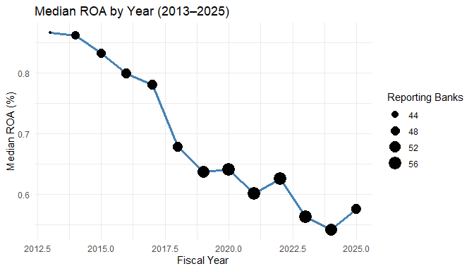
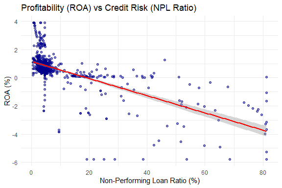

Commercial Bank Financial Performance in Bangladesh
================
Wasif Hoq
2026-11-11

- [1. Project Overview & Empirical
  Architecture](#1-project-overview--empirical-architecture)
- [2. Stage 1: Data Loading & Panel Inspection
  (`scripts/load_inspect.R`)](#2-stage-1-data-loading--panel-inspection-scriptsload_inspectr)
  - [2.1 Loading Required Packages](#21-loading-required-packages)
  - [2.2 Data Ingestion & Initial
    Glimpse](#22-data-ingestion--initial-glimpse)
  - [2.3 Fixing Data Types](#23-fixing-data-types)
  - [2.4 Data Integrity & Missing Values
    Audit](#24-data-integrity--missing-values-audit)
  - [2.5 Distribution of Observations Across Banks and
    Years](#25-distribution-of-observations-across-banks-and-years)
  - [2.6 Duplicate Dyad Verification](#26-duplicate-dyad-verification)
  - [2.7 Full Panel Declaration](#27-full-panel-declaration)
- [3. Stage 2: Data Exploration, Outlier Treatment & Sample Construction
  (`scripts/explore_data.R`)](#3-stage-2-data-exploration-outlier-treatment--sample-construction-scriptsexplore_datar)
  - [3.1 Accounting Identity Verification: Return on Assets
    (ROA)](#31-accounting-identity-verification-return-on-assets-roa)
  - [3.2 Outlier Inspection &
    Decisions](#32-outlier-inspection--decisions)
  - [3.3 Sample Window Restriction
    (2013–2025)](#33-sample-window-restriction-20132025)
  - [3.4 Winsorization at 1st and 99th
    Percentiles](#34-winsorization-at-1st-and-99th-percentiles)
  - [3.5 Re-Declaring Cleaned Panel
    Structure](#35-re-declaring-cleaned-panel-structure)
  - [3.6 Summary Statistics of Modeling
    Variables](#36-summary-statistics-of-modeling-variables)
  - [3.7 Correlation Matrix](#37-correlation-matrix)
  - [3.8 Exploratory Visualizations](#38-exploratory-visualizations)
  - [3.9 Exporting Cleaned Dataset](#39-exporting-cleaned-dataset)
- [4. Stage 3: Econometric Modeling & Diagnostics
  (`scripts/data_modeling.R`)](#4-stage-3-econometric-modeling--diagnostics-scriptsdata_modelingr)
  - [4.1 Model Setup & Specification](#41-model-setup--specification)
  - [4.2 Estimation of the Three Canonical Panel
    Models](#42-estimation-of-the-three-canonical-panel-models)
  - [4.3 Formal Model Specification
    Tests](#43-formal-model-specification-tests)
  - [4.4 Model Comparison Table](#44-model-comparison-table)
- [5. Stage 4: Post-Estimation Diagnostics & Cluster-Robust
  Inference](#5-stage-4-post-estimation-diagnostics--cluster-robust-inference)
  - [5.1 Multicollinearity Check: Variance Inflation Factor
    (VIF)](#51-multicollinearity-check-variance-inflation-factor-vif)
  - [5.2 Heteroskedasticity Check: Breusch-Pagan
    Test](#52-heteroskedasticity-check-breusch-pagan-test)
  - [5.3 Serial Correlation Check: Breusch-Godfrey / Wooldridge
    Test](#53-serial-correlation-check-breusch-godfrey--wooldridge-test)
  - [5.4 Cluster-Robust Standard Error
    Correction](#54-cluster-robust-standard-error-correction)
  - [5.5 Comprehensive Model Summary
    Table](#55-comprehensive-model-summary-table)
- [6. Summary of Key Findings](#6-summary-of-key-findings)

# 1. Project Overview & Empirical Architecture

This study investigates the financial determinants of commercial bank
performance in Bangladesh using panel econometric techniques.
Specifically, we examine the quantitative impact of credit risk
(non-performing loans), capital adequacy, bank size, and liquidity
deployment on operating profitability (Return on Assets).

The empirical workflow strictly follows three core R scripts: 1.
**`scripts/load_inspect.R`**: Data loading, type casting, health audits,
missing value checks, and initial panel declaration. 2.
**`scripts/explore_data.R`**: Accounting identity validation, outlier
identification and handling, temporal sample restriction (2013–2025),
two-tailed winsorization (1st and 99th percentiles), exploratory data
visualization, and correlation structure analysis. 3.
**`scripts/data_modeling.R`**: Panel econometric estimation across
Pooled OLS, Fixed Effects (Within), and Random Effects (GLS), formal
specification testing (Chow F-test, Breusch-Pagan LM test, Hausman
test), post-estimation regression diagnostics (VIF multicollinearity,
Breusch-Pagan heteroskedasticity, Breusch-Godfrey serial correlation),
and cluster-robust standard error inference.

------------------------------------------------------------------------

# 2. Stage 1: Data Loading & Panel Inspection (`scripts/load_inspect.R`)

The first script loads the necessary packages, imports the raw bank
panel data, audits its dimensions and integrity, fixes variable types,
and establishes the panel structure.

### 2.1 Loading Required Packages

We load `tidyverse` for data manipulation, reshaping, and plotting, and
`plm` for panel data econometric modeling. We also import `car`,
`lmtest`, `sandwich`, and `modelsummary` which are utilized in
subsequent diagnostic and modeling stages.

``` r
library(tidyverse)
library(plm)
library(car)
library(lmtest)
library(sandwich)
library(modelsummary)
```

### 2.2 Data Ingestion & Initial Glimpse

The raw data is stored in `data/processed_BD_Banks_features_final.csv`,
sourced from the public Mendeley Data repository (*“A comprehensive
panel dataset of Bangladeshi banks (1997-2025)”*, Yeasmin).

``` r
raw <- read_csv("data/processed_BD_Banks_features_final.csv")
glimpse(raw)
```

    ## Rows: 780
    ## Columns: 25
    ## $ bank              <chr> "AB Bank PLC", "AB Bank PLC", "AB Bank PLC", "AB Ban…
    ## $ year              <dbl> 2008, 2009, 2010, 2011, 2012, 2013, 2014, 2015, 2016…
    ## $ basis             <chr> "solo", "solo", "solo", "solo", "solo", "solo", "sol…
    ## $ unit              <chr> "BDT million", "BDT million", "BDT million", "BDT mi…
    ## $ total_assets      <dbl> 94500, 112600, 132988, 158600, 184200, 211800, 25130…
    ## $ total_loans       <dbl> 61200, 72500, 88299, 106300, 125100, 142500, 168900,…
    ## $ deposits          <dbl> 78300, 91400, 95702, 115200, 134800, 154600, 181400,…
    ## $ equity            <dbl> 8900, 10800, 13867, 15800, 17900, 19300, 20800, 2210…
    ## $ net_income        <dbl> 2150, 2940, 3696, 2120, 1650, 1210, 1480, 1420, 1510…
    ## $ npl_ratio_pct     <dbl> 3.40, 3.10, 3.20, 3.80, 4.10, 4.60, 4.90, 5.80, 6.50…
    ## $ car_crar_pct      <dbl> 11.90, 13.20, 13.10, 12.60, 12.10, 11.90, 11.50, 11.…
    ## $ roa               <dbl> 2.2751, 2.6110, 2.7792, 1.3367, 0.8958, 0.5713, 0.58…
    ## $ roe               <dbl> 24.1573, 27.2222, 26.6532, 13.4177, 9.2179, 6.2694, …
    ## $ ldr               <dbl> 78.1609, 79.3217, 92.2645, 92.2743, 92.8042, 92.1734…
    ## $ loan_to_assets    <dbl> 64.7619, 64.3872, 66.3962, 67.0240, 67.9153, 67.2805…
    ## $ deposit_to_assets <dbl> 82.8571, 81.1723, 71.9629, 72.6356, 73.1813, 72.9934…
    ## $ equity_to_assets  <dbl> 9.4180, 9.5915, 10.4273, 9.9622, 9.7177, 9.1124, 8.2…
    ## $ size_ln_assets    <dbl> 11.4564, 11.6316, 11.7980, 11.9741, 12.1238, 12.2634…
    ## $ car_surplus       <dbl> 1.90, 3.20, 3.10, 2.60, 2.10, 1.90, 1.50, 1.80, 1.40…
    ## $ asset_growth      <dbl> 11.7225, 19.1534, 18.1066, 19.2589, 16.1412, 14.9837…
    ## $ loan_growth       <dbl> 12.3133, 18.4641, 21.7917, 20.3864, 17.6858, 13.9089…
    ## $ deposit_growth    <dbl> 11.2417, 16.7305, 4.7068, 20.3737, 17.0139, 14.6884,…
    ## $ profit_growth     <dbl> 10.3572, 36.7442, 25.7143, -42.6407, -22.1698, -26.6…
    ## $ zscore            <dbl> 12.4565, 12.9991, 14.0686, 12.0365, 11.3063, 10.3158…
    ## $ ln_zscore         <dbl> 2.5222, 2.5649, 2.6439, 2.4879, 2.4254, 2.3337, 2.24…

The raw dataset contains 780 observations across 25 financial variables
for 57 commercial banks in Bangladesh, spanning the historical period
from 1997 to 2025.

### 2.3 Fixing Data Types

Panel econometrics requires explicitly distinguishing categorical entity
identifiers from temporal indexes. We convert `bank` to a factor and
`year` to an integer:

``` r
df <- raw |>
  mutate(bank = as.factor(bank),     
         year = as.integer(year))    
```

### 2.4 Data Integrity & Missing Values Audit

We run summary statistics on all variables and check for any missing
values (`NA`):

``` r
summary(df)
```

    ##                          bank          year            basis    
    ##  Al-Arafah Islami Bank PLC : 29   Min.   :1997   Length   :780  
    ##  EXIM Bank PLC             : 25   1st Qu.:2014   N.unique :  1  
    ##  United Commercial Bank PLC: 24   Median :2018   N.blank  :  0  
    ##  Prime Bank PLC            : 23   Mean   :2018   Min.nchar:  4  
    ##  Bank Asia                 : 21   3rd Qu.:2022   Max.nchar:  4  
    ##  Eastern Bank PLC          : 19   Max.   :2025                  
    ##  (Other)                   :639                                 
    ##         unit      total_assets        total_loans           deposits        
    ##  Length   :780   Min.   :2.552e+01   Min.   :3.440e+00   Min.   :3.000e-02  
    ##  N.unique :  1   1st Qu.:6.966e+04   1st Qu.:4.755e+04   1st Qu.:5.586e+04  
    ##  N.blank  :  0   Median :2.052e+05   Median :1.456e+05   Median :1.565e+05  
    ##  Min.nchar: 11   Mean   :2.854e+05   Mean   :1.932e+05   Mean   :2.215e+05  
    ##  Max.nchar: 11   3rd Qu.:3.713e+05   3rd Qu.:2.664e+05   3rd Qu.:2.851e+05  
    ##                  Max.   :2.391e+06   Max.   :1.849e+06   Max.   :1.796e+06  
    ##                                                                             
    ##      equity          net_income        npl_ratio_pct     car_crar_pct    
    ##  Min.   :-250171   Min.   :-261420.0   Min.   : 0.040   Min.   :-405.31  
    ##  1st Qu.:   6523   1st Qu.:    450.0   1st Qu.: 3.115   1st Qu.:  10.85  
    ##  Median :  15100   Median :   1350.0   Median : 4.500   Median :  12.42  
    ##  Mean   :  17879   Mean   :    895.6   Mean   : 9.457   Mean   :  11.16  
    ##  3rd Qu.:  23973   3rd Qu.:   2410.0   3rd Qu.: 6.250   3rd Qu.:  14.80  
    ##  Max.   :1088997   Max.   :  13450.0   Max.   :97.800   Max.   : 319.55  
    ##                                                                          
    ##       roa                roe                ldr            loan_to_assets   
    ##  Min.   :-87.1922   Min.   :-536.908   Min.   :   0.0152   Min.   : 0.0143  
    ##  1st Qu.:  0.4525   1st Qu.:   7.007   1st Qu.:  78.9158   1st Qu.:61.6976  
    ##  Median :  0.7774   Median :   9.591   Median :  90.0622   Median :68.9815  
    ##  Mean   :  0.4468   Mean   :   8.212   Mean   : 101.1557   Mean   :65.9335  
    ##  3rd Qu.:  1.1658   3rd Qu.:  13.629   3rd Qu.:  96.6445   3rd Qu.:75.3822  
    ##  Max.   :  7.2381   Max.   :  42.914   Max.   :1481.5261   Max.   :97.3367  
    ##                                                                             
    ##  deposit_to_assets  equity_to_assets   size_ln_assets   car_surplus      
    ##  Min.   :  0.0006   Min.   :-149.464   Min.   : 3.24   Min.   :-415.310  
    ##  1st Qu.: 72.3480   1st Qu.:   5.964   1st Qu.:11.15   1st Qu.:   0.900  
    ##  Median : 77.3126   Median :   7.630   Median :12.23   Median :   2.420  
    ##  Mean   : 75.4117   Mean   :   8.811   Mean   :11.91   Mean   :   1.162  
    ##  3rd Qu.: 81.0726   3rd Qu.:  10.106   3rd Qu.:12.82   3rd Qu.:   4.805  
    ##  Max.   :125.1353   Max.   : 807.168   Max.   :14.69   Max.   : 309.550  
    ##                                                                          
    ##   asset_growth        loan_growth       deposit_growth      
    ##  Min.   :  -71.086   Min.   : -59.479   Min.   :     -78.9  
    ##  1st Qu.:    8.112   1st Qu.:   7.898   1st Qu.:       7.8  
    ##  Median :   11.723   Median :  12.313   Median :      11.2  
    ##  Mean   :   38.931   Mean   :  35.081   Mean   :   18876.1  
    ##  3rd Qu.:   17.339   3rd Qu.:  18.149   3rd Qu.:      16.6  
    ##  Max.   :16882.837   Max.   :6207.031   Max.   :14691433.3  
    ##                                                             
    ##  profit_growth            zscore          ln_zscore     
    ##  Min.   :-16946.667   Min.   :-136.52   Min.   :-1.521  
    ##  1st Qu.:    -4.131   1st Qu.:  11.62   1st Qu.: 2.619  
    ##  Median :    10.357   Median :  20.59   Median : 3.109  
    ##  Mean   :    37.485   Mean   :  35.22   Mean   : 3.091  
    ##  3rd Qu.:    22.518   3rd Qu.:  37.76   3rd Qu.: 3.631  
    ##  Max.   : 55960.000   Max.   :3087.78   Max.   : 8.035  
    ## 

``` r
colSums(is.na(df))                          
```

    ##              bank              year             basis              unit 
    ##                 0                 0                 0                 0 
    ##      total_assets       total_loans          deposits            equity 
    ##                 0                 0                 0                 0 
    ##        net_income     npl_ratio_pct      car_crar_pct               roa 
    ##                 0                 0                 0                 0 
    ##               roe               ldr    loan_to_assets deposit_to_assets 
    ##                 0                 0                 0                 0 
    ##  equity_to_assets    size_ln_assets       car_surplus      asset_growth 
    ##                 0                 0                 0                 0 
    ##       loan_growth    deposit_growth     profit_growth            zscore 
    ##                 0                 0                 0                 0 
    ##         ln_zscore 
    ##                 0

The missing value audit confirms that all 25 columns have **0 missing
values** across all 780 bank-year observations.

### 2.5 Distribution of Observations Across Banks and Years

Next, we evaluate panel balance by counting the number of reporting
years per bank and the number of active banks per calendar year:

``` r
df |> count(bank) |> print(n = 57)          
```

    ## # A tibble: 57 × 2
    ##    bank                                           n
    ##    <fct>                                      <int>
    ##  1 AB Bank PLC                                   18
    ##  2 Agrani Bank PLC                               12
    ##  3 Al-Arafah Islami Bank PLC                     29
    ##  4 Bangladesh Commerce Bank Limited (BCBL)        5
    ##  5 Bangladesh Development Bank PLC                7
    ##  6 Bangladesh Krishi Bank                        10
    ##  7 Bank Alfalah Limited                          13
    ##  8 Bank Asia                                     21
    ##  9 BASIC Bank PLC                                12
    ## 10 Bengal Commercial Bank PLC                     6
    ## 11 BRAC Bank PLC                                  6
    ## 12 Citibank N.A                                  13
    ## 13 Citizens Bank PLC                              6
    ## 14 City Bank PLC                                 13
    ## 15 Community Bank Bangladesh PLC                  7
    ## 16 Dhaka Bank PLC                                 7
    ## 17 Dutch-Bangla Bank PLC                         15
    ## 18 Eastern Bank PLC                              19
    ## 19 EXIM Bank PLC                                 25
    ## 20 First Security Islami Bank PLC                14
    ## 21 Global Islami Bank PLC                        13
    ## 22 Grameen Bank                                   5
    ## 23 HSBC Bangladesh                               13
    ## 24 ICB Islamic Bank PLC                          13
    ## 25 IFIC Bank PLC                                 16
    ## 26 Islami Bank Bangladesh PLC                    19
    ## 27 Jamuna Bank PLC                               15
    ## 28 Janata Bank PLC                               12
    ## 29 Meghna Bank PLC                               13
    ## 30 Mercantile Bank PLC                           17
    ## 31 Midland Bank PLC                              13
    ## 32 Modhumoti Bank PLC                            13
    ## 33 Mutual Trust Bank PLC                         13
    ## 34 National Bank PLC                             13
    ## 35 NCC Bank PLC                                  15
    ## 36 NRB Bank PLC                                  13
    ## 37 NRBC Bank PLC                                 13
    ## 38 One Bank PLC                                  16
    ## 39 Premier Bank PLC                              14
    ## 40 Prime Bank PLC                                23
    ## 41 Probashi Kallyan Bank                         13
    ## 42 Pubali Bank PLC                               14
    ## 43 Rajshahi Krishi Unnayan Bank                  10
    ## 44 Rupali Bank PLC                               12
    ## 45 SBAC Bank                                     13
    ## 46 Shahjalal Islami Bank PLC                     19
    ## 47 Shimanto Bank PLC                             10
    ## 48 Social Islami Bank PLC                        14
    ## 49 Sonali Bank PLC                               12
    ## 50 Southeast Bank PLC                            13
    ## 51 Standard Bank PLC                             15
    ## 52 Standard Chartered Bank Bangladesh            14
    ## 53 State Bank of India, Bangladesh Operations    13
    ## 54 Trust Bank PLC                                18
    ## 55 Union Bank PLC                                13
    ## 56 United Commercial Bank PLC                    24
    ## 57 Uttara Bank PLC                               13

``` r
df |> count(year) |> print(n = 29)          
```

    ## # A tibble: 29 × 2
    ##     year     n
    ##    <int> <int>
    ##  1  1997     1
    ##  2  1998     1
    ##  3  1999     1
    ##  4  2000     1
    ##  5  2001     2
    ##  6  2002     3
    ##  7  2003     4
    ##  8  2004     4
    ##  9  2005     5
    ## 10  2006     5
    ## 11  2007     8
    ## 12  2008    10
    ## 13  2009    11
    ## 14  2010    14
    ## 15  2011    17
    ## 16  2012    22
    ## 17  2013    41
    ## 18  2014    46
    ## 19  2015    48
    ## 20  2016    49
    ## 21  2017    49
    ## 22  2018    50
    ## 23  2019    55
    ## 24  2020    57
    ## 25  2021    57
    ## 26  2022    57
    ## 27  2023    57
    ## 28  2024    55
    ## 29  2025    50

**Key Empirical Insights:** - Individual bank reporting spans range from
5 years to 29 years. - Prior to 2013, reporting coverage is sparse
(ranging from only 1 bank in 1997 to 22 banks in 2012). - From 2013
onwards, reporting stabilizes with 41 to 57 banks consistently reporting
annually. This finding informs our sample window selection in Stage 2.

### 2.6 Duplicate Dyad Verification

In panel econometric estimation, every bank-year pair $(i, t)$ must be
uniquely observed:

``` r
sum(duplicated(df[c("bank", "year")]))      
```

    ## [1] 0

The count is **0**, confirming that no duplicate bank-year observations
exist.

### 2.7 Full Panel Declaration

We declare the raw panel using `pdata.frame()` with `bank` as the
individual index and `year` as the time index, and verify panel
dimensions using `pdim()`:

``` r
# Declare panel (full data)
pdata <- pdata.frame(df, index = c("bank", "year"))
pdim(pdata)   
```

    ## Unbalanced Panel: n = 57, T = 5-29, N = 780

The structure is confirmed as an **Unbalanced Panel** with $n = 57$
banks, $T = 5 \text{ to } 29$ time periods per bank, and $N = 780$ total
bank-year observations.

------------------------------------------------------------------------

# 3. Stage 2: Data Exploration, Outlier Treatment & Sample Construction (`scripts/explore_data.R`)

In the second stage, we conduct accounting formula sanity checks, detect
extreme outliers, restrict the temporal window, winsorize heavy-tailed
variables, compute descriptive statistics and correlation matrices, and
generate exploratory plots.

### 3.1 Accounting Identity Verification: Return on Assets (ROA)

By accounting definition, Return on Assets is defined as:
$$\text{ROA} = \frac{\text{Net Income}}{\text{Total Assets}} \times 100$$

We verify whether the reported `roa` column mathematically aligns with
`net_income` divided by `total_assets`:

``` r
df |>
  mutate(check = net_income / total_assets * 100) |>
  select(bank, year, roa, check) |>
  head(10)
```

    ## # A tibble: 10 × 4
    ##    bank         year   roa check
    ##    <fct>       <int> <dbl> <dbl>
    ##  1 AB Bank PLC  2008 2.28  2.28 
    ##  2 AB Bank PLC  2009 2.61  2.61 
    ##  3 AB Bank PLC  2010 2.78  2.78 
    ##  4 AB Bank PLC  2011 1.34  1.34 
    ##  5 AB Bank PLC  2012 0.896 0.896
    ##  6 AB Bank PLC  2013 0.571 0.571
    ##  7 AB Bank PLC  2014 0.589 0.589
    ##  8 AB Bank PLC  2015 0.499 0.499
    ##  9 AB Bank PLC  2016 0.480 0.480
    ## 10 AB Bank PLC  2017 0.118 0.118

The computed values match the reported `roa` values exactly.

> **Econometric Precaution**: Because net income is the numerator of
> ROA, net income, ROE, and related profit variables must not be
> included as explanatory variables in ROA regressions to avoid
> tautological endogeneity.

### 3.2 Outlier Inspection & Decisions

We sort observations by `roa` to isolate the most severe loss years and
evaluate balance sheet fundamentals:

``` r
df |>
  arrange(roa) |>
  select(bank, year, roa, total_assets, equity, net_income) |>
  head(10)
```

    ## # A tibble: 10 × 6
    ##    bank                          year    roa total_assets    equity net_income
    ##    <fct>                        <int>  <dbl>        <dbl>     <dbl>      <dbl>
    ##  1 Union Bank PLC                2024 -87.2      299820.  -250171.   -261420  
    ##  2 Citizens Bank PLC             2020 -79.6          25.5     -20.3      -20.3
    ##  3 Bangladesh Krishi Bank        2024 -14.8      441566.  -192502.    -65134. 
    ##  4 Rajshahi Krishi Unnayan Bank  2020  -7.93       7750.     -870.      -615. 
    ##  5 BASIC Bank PLC                2016  -7.29     204740.    10808.    -14930. 
    ##  6 National Bank PLC             2022  -6.3      521446     41664     -32851  
    ##  7 Rajshahi Krishi Unnayan Bank  2021  -5.90       8214.    -1361.      -484. 
    ##  8 BASIC Bank PLC                2024  -5.82     148351.   -14541.     -8631. 
    ##  9 Bangladesh Krishi Bank        2023  -5.77     413529.  -127913.    -23848. 
    ## 10 ICB Islamic Bank PLC          2024  -5.26       9243    -13815       -486

Two extreme outliers are observed: 1. **Citizens Bank PLC (2020)**:
Reported ROA is $-79.6\%$, but total assets are recorded as only $25.5$
million BDT (with equity and net income of $-20.3$ million BDT). Typical
commercial banks operate with total assets in hundreds of billions of
BDT. A total asset base of 25.5 represents an extreme recording/scaling
anomaly. - **Decision: DROPPED**. The tiny asset denominator distorts
ratio calculation and represents an unverified data anomaly. 2. **Union
Bank PLC (2024)**: Reported ROA is $-87.2\%$, with total assets of
$299,820$ million BDT and a massive net loss of $-261,420$ million
BDT. - **Decision: KEPT and WINSORIZED**. Unlike Citizens Bank, Union
Bank’s asset scale is standard; this represents a real systemic distress
event in Bangladesh’s banking sector. Dropping it would artificially
censor real risk dynamics, but leaving $-87.2\%$ untransformed would
exert excessive leverage on regression lines.

### 3.3 Sample Window Restriction (2013–2025)

To construct a robust panel with broad sectoral coverage and eliminate
the distortionary Citizens Bank 2020 record, we restrict the analysis
window to 2013–2025:

``` r
# Window 2013-2025: few banks report before that
dfm <- df |>
  filter(year >= 2013) |>
  filter(!(bank == "Citizens Bank PLC" & year == 2020))

nrow(dfm)               
```

    ## [1] 670

``` r
n_distinct(dfm$bank)   
```

    ## [1] 57

The filtered sample contains **670 bank-year observations** across **57
commercial banks**.

### 3.4 Winsorization at 1st and 99th Percentiles

To protect our econometric estimators against extreme tail leverage
while preserving genuine distressed observations, we winsorize
continuous predictors and the dependent variable at the 1st and 99th
percentiles:

``` r
# Values below the 1st or above the 99th percentile are replaced by those limits
winsor <- function(x, p = 0.01) {
  q <- quantile(x, c(p, 1 - p), na.rm = TRUE)
  pmin(pmax(x, q[1]), q[2])
}

dfm <- dfm |>
  mutate(across(c(roa, npl_ratio_pct, car_crar_pct, size_ln_assets, ldr),
                winsor, .names = "{.col}_w"))    

summary(dfm[c("roa", "roa_w", "ldr", "ldr_w")])  
```

    ##       roa               roa_w              ldr                ldr_w         
    ##  Min.   :-87.1922   Min.   :-5.7828   Min.   :   0.0152   Min.   :  0.9047  
    ##  1st Qu.:  0.3518   1st Qu.: 0.3518   1st Qu.:  76.8491   1st Qu.: 76.8491  
    ##  Median :  0.6934   Median : 0.6934   Median :  89.7343   Median : 89.7343  
    ##  Mean   :  0.3942   Mean   : 0.5262   Mean   : 102.9827   Mean   : 97.9085  
    ##  3rd Qu.:  1.0316   3rd Qu.: 1.0316   3rd Qu.:  96.7730   3rd Qu.: 96.7730  
    ##  Max.   :  7.2381   Max.   : 3.8984   Max.   :1481.5261   Max.   :857.8209

Winsorization effectively limits the extreme negative minimum of ROA
from $-87.19\%$ to $-5.78\%$ and bounds loan-to-deposit ratio outliers,
creating stable distribution properties.

### 3.5 Re-Declaring Cleaned Panel Structure

We re-declare the cleaned panel dataframe and check dimensions:

``` r
pdatam <- pdata.frame(dfm, index = c("bank", "year"))
pdim(pdatam)      
```

    ## Unbalanced Panel: n = 57, T = 5-13, N = 670

The resulting structure is an **Unbalanced Panel**: $n = 57$ banks,
$T = 5 \text{ to } 13$ years per bank, and $N = 670$ total observations.

### 3.6 Summary Statistics of Modeling Variables

We inspect the central tendencies and dispersion of our winsorized
modeling variables:

``` r
dfm |>
  select(roa_w, npl_ratio_pct_w, car_crar_pct_w, size_ln_assets_w, ldr_w) |>
  summary()
```

    ##      roa_w         npl_ratio_pct_w car_crar_pct_w    size_ln_assets_w
    ##  Min.   :-5.7828   Min.   : 0.50   Min.   :-130.93   Min.   : 8.40   
    ##  1st Qu.: 0.3518   1st Qu.: 3.24   1st Qu.:  11.20   1st Qu.:11.28   
    ##  Median : 0.6934   Median : 4.59   Median :  12.80   Median :12.42   
    ##  Mean   : 0.5262   Mean   :10.36   Mean   :  11.02   Mean   :12.04   
    ##  3rd Qu.: 1.0316   3rd Qu.: 6.85   3rd Qu.:  15.30   3rd Qu.:12.92   
    ##  Max.   : 3.8984   Max.   :81.31   Max.   : 131.94   Max.   :14.41   
    ##      ldr_w         
    ##  Min.   :  0.9047  
    ##  1st Qu.: 76.8491  
    ##  Median : 89.7343  
    ##  Mean   : 97.9085  
    ##  3rd Qu.: 96.7730  
    ##  Max.   :857.8209

- **`roa_w` (Profitability)**: Median of $0.693\%$, mean of $0.526\%$,
  ranging from $-5.783\%$ to $3.898\%$.
- **`npl_ratio_pct_w` (Credit Risk)**: Median of $4.59\%$, mean of
  $10.36\%$, reflecting substantial positive skewness driven by troubled
  institutions.
- **`car_crar_pct_w` (Capital Buffer)**: Median of $12.80\%$, mean of
  $11.02\%$.
- **`size_ln_assets_w` (Bank Size)**: Median of $12.42$, mean of
  $12.04$.
- **`ldr_w` (Liquidity Deployment)**: Median of $89.73\%$, mean of
  $97.91\%$.

### 3.7 Correlation Matrix

We evaluate pairwise Pearson correlation coefficients across the
modeling variables:

``` r
dfm |>
  select(roa_w, npl_ratio_pct_w, car_crar_pct_w, size_ln_assets_w, ldr_w) |>
  cor() |>
  round(2)
```

    ##                  roa_w npl_ratio_pct_w car_crar_pct_w size_ln_assets_w ldr_w
    ## roa_w             1.00           -0.67           0.56            -0.02  0.22
    ## npl_ratio_pct_w  -0.67            1.00          -0.63            -0.04 -0.08
    ## car_crar_pct_w    0.56           -0.63           1.00            -0.04  0.10
    ## size_ln_assets_w -0.02           -0.04          -0.04             1.00 -0.16
    ## ldr_w             0.22           -0.08           0.10            -0.16  1.00

**Key Correlation Observations:** - A strong negative correlation of
**$-0.67$** exists between `roa_w` and `npl_ratio_pct_w`, confirming
that asset quality deterioration is inversely associated with
profitability. - Capital adequacy (`car_crar_pct_w`) exhibits a positive
correlation with ROA ($+0.56$) and an inverse correlation with bad loans
($-0.63$). - None of the independent predictor correlations exceed
$0.70$, indicating that severe bivariate multicollinearity is not
present.

### 3.8 Exploratory Visualizations

We generate and export two analytical visualizations:

#### A. Median ROA Trajectory (2013–2025)

``` r
dir.create("output", showWarnings = FALSE)

p1 <- dfm |>
  group_by(year) |>
  summarise(median_roa = median(roa_w), n_banks = n()) |>
  ggplot(aes(year, median_roa)) +
  geom_line(color = "steelblue", linewidth = 1.2) +
  geom_point(aes(size = n_banks)) +
  labs(title = "Median ROA by year, 2013-2025",
       x = "Year", y = "Median ROA (%)", size = "Banks")

print(p1)
```

<!-- -->

``` r
ggsave("output/median_roa_by_year.png", plot = p1, width = 7, height = 4)
```

The median sector ROA remained stable around $0.7\%$ to $0.8\%$ between
2013 and 2022, before experiencing a sharp downturn in 2023–2024.

#### B. Scatterplot: ROA vs. NPL Ratio

``` r
p2 <- ggplot(dfm, aes(npl_ratio_pct_w, roa_w)) +
  geom_point(alpha = 0.5) +
  geom_smooth(method = "lm", color = "red") +
  labs(title = "ROA vs NPL", x = "NPL (%)", y = "ROA (%)")

print(p2)
```

<!-- -->

``` r
ggsave("output/roa_vs_npl.png", plot = p2, width = 6, height = 4)
```

The fitted regression line displays a clear, steep negative slope,
underscoring the depressive effect of loan defaults on operating
returns.

### 3.9 Exporting Cleaned Dataset

We serialize the cleaned, winsorized 2013–2025 dataset to disk for model
estimation:

``` r
write_rds(dfm, "data/dfm_2013_2025.rds")
```

------------------------------------------------------------------------

# 4. Stage 3: Econometric Modeling & Diagnostics (`scripts/data_modeling.R`)

The third stage carries out panel model estimation, hypothesis testing
for model selection, post-estimation residual diagnostics, and
cluster-robust standard error estimation.

### 4.1 Model Setup & Specification

We load the serialized sample `dfm_2013_2025.rds`, re-instantiate the
panel data structure, and define our empirical model specification:

$$\text{ROA}_{it} = \beta_0 + \beta_1 \text{NPL}_{it} + \beta_2 \text{CAR}_{it} + \beta_3 \text{Size}_{it} + \beta_4 \text{LDR}_{it} + \alpha_i + \varepsilon_{it}$$

``` r
dfm <- read_rds("data/dfm_2013_2025.rds")

pdatam <- pdata.frame(dfm, index = c("bank", "year"))
pdim(pdatam)       
```

    ## Unbalanced Panel: n = 57, T = 5-13, N = 670

``` r
# ROA explained by NPL, CAR, size and LDR (one formula for all models)
f <- roa_w ~ npl_ratio_pct_w + car_crar_pct_w + size_ln_assets_w + ldr_w
```

### 4.2 Estimation of the Three Canonical Panel Models

We estimate three canonical panel econometric models: 1. **Pooled OLS**:
Assumes homogeneous slope coefficients and intercepts across all banks
($\alpha_i = \alpha$). 2. **Fixed Effects (Within Model)**: Allows
bank-specific unobserved intercepts ($\alpha_i$) correlated with
regressors, purging cross-sectional heterogeneity via group-demeaning.
3. **Random Effects (GLS Model)**: Assumes bank-specific effects
($\alpha_i$) are random disturbances uncorrelated with regressors
($\text{Cov}(\alpha_i, X_{it}) = 0$).

``` r
pooled <- plm(f, data = pdatam, model = "pooling")  
fe     <- plm(f, data = pdatam, model = "within")   
re     <- plm(f, data = pdatam, model = "random")    
```

#### A. Pooled OLS Summary

``` r
summary(pooled)
```

    ## Pooling Model
    ## 
    ## Call:
    ## plm(formula = f, data = pdatam, model = "pooling")
    ## 
    ## Unbalanced Panel: n = 57, T = 5-13, N = 670
    ## 
    ## Residuals:
    ##     Min.  1st Qu.   Median  3rd Qu.     Max. 
    ## -5.57654 -0.22501  0.00555  0.27235  4.31290 
    ## 
    ## Coefficients:
    ##                     Estimate  Std. Error  t-value  Pr(>|t|)    
    ## (Intercept)       0.82255136  0.37573866   2.1892   0.02893 *  
    ## npl_ratio_pct_w  -0.04751697  0.00315882 -15.0426 < 2.2e-16 ***
    ## car_crar_pct_w    0.01034541  0.00168603   6.1360 1.454e-09 ***
    ## size_ln_assets_w -0.01294295  0.02970267  -0.4358   0.66316    
    ## ldr_w             0.00242835  0.00043541   5.5771 3.559e-08 ***
    ## ---
    ## Signif. codes:  0 '***' 0.001 '**' 0.01 '*' 0.05 '.' 0.1 ' ' 1
    ## 
    ## Total Sum of Squares:    1338.2
    ## Residual Sum of Squares: 653.54
    ## R-Squared:      0.51162
    ## Adj. R-Squared: 0.50869
    ## F-statistic: 174.164 on 4 and 665 DF, p-value: < 2.22e-16

- In Pooled OLS, `npl_ratio_pct_w` is negative and highly significant
  ($\hat{\beta} = -0.0475$, $p < 2.2 \times 10^{-16}$).
- Both `car_crar_pct_w` ($\hat{\beta} = 0.0103$,
  $p = 1.45 \times 10^{-9}$) and `ldr_w` ($\hat{\beta} = 0.0024$,
  $p = 3.56 \times 10^{-8}$) are positive and significant.
- `size_ln_assets_w` is statistically insignificant ($p = 0.663$).
  Overall $R^2 = 0.512$.

#### B. Fixed Effects (Within) Summary

``` r
summary(fe)
```

    ## Oneway (individual) effect Within Model
    ## 
    ## Call:
    ## plm(formula = f, data = pdatam, model = "within")
    ## 
    ## Unbalanced Panel: n = 57, T = 5-13, N = 670
    ## 
    ## Residuals:
    ##     Min.  1st Qu.   Median  3rd Qu.     Max. 
    ## -4.96966 -0.15841 -0.00767  0.12840  3.06424 
    ## 
    ## Coefficients:
    ##                     Estimate  Std. Error  t-value Pr(>|t|)    
    ## npl_ratio_pct_w  -4.4260e-02  3.6467e-03 -12.1370   <2e-16 ***
    ## car_crar_pct_w    8.4830e-04  1.9732e-03   0.4299   0.6674    
    ## size_ln_assets_w -1.2150e-02  5.7601e-02  -0.2109   0.8330    
    ## ldr_w            -9.6858e-05  4.9851e-04  -0.1943   0.8460    
    ## ---
    ## Signif. codes:  0 '***' 0.001 '**' 0.01 '*' 0.05 '.' 0.1 ' ' 1
    ## 
    ## Total Sum of Squares:    323.24
    ## Residual Sum of Squares: 252.41
    ## R-Squared:      0.21915
    ## Adj. R-Squared: 0.14222
    ## F-statistic: 42.7295 on 4 and 609 DF, p-value: < 2.22e-16

- `npl_ratio_pct_w` remains strongly negative and highly significant
  ($\hat{\beta} = -0.0443$, $p < 2 \times 10^{-16}$). A 1 percentage
  point increase in bad loans reduces within-bank ROA by approximately
  $0.044$ percentage points.
- Crucially, `car_crar_pct_w` ($p = 0.667$), `size_ln_assets_w`
  ($p = 0.833$), and `ldr_w` ($p = 0.846$) lose statistical
  significance.
- Within-$R^2 = 0.219$.

> **Econometric Insight (Between vs. Within Effects)**: Why do CAR and
> LDR lose significance in Fixed Effects? Pooled OLS captures both
> *between-bank* and *within-bank* variation. Higher-quality,
> well-capitalized banks consistently earn higher profits in
> cross-section. However, once unobserved bank-specific heterogeneity is
> demeaned out, short-term annual variations in capital cushions or
> loan-to-deposit ratios within a single bank do not translate to
> significant ROA fluctuations. Asset quality (NPL) is the dominant
> internal driver of operating performance.

#### C. Random Effects Summary

``` r
summary(re)
```

    ## Oneway (individual) effect Random Effect Model 
    ##    (Swamy-Arora's transformation)
    ## 
    ## Call:
    ## plm(formula = f, data = pdatam, model = "random")
    ## 
    ## Unbalanced Panel: n = 57, T = 5-13, N = 670
    ## 
    ## Effects:
    ##                  var std.dev share
    ## idiosyncratic 0.4145  0.6438 0.417
    ## individual    0.5797  0.7614 0.583
    ## theta:
    ##    Min. 1st Qu.  Median    Mean 3rd Qu.    Max. 
    ##  0.6463  0.7717  0.7717  0.7624  0.7717  0.7717 
    ## 
    ## Residuals:
    ##     Min.  1st Qu.   Median     Mean  3rd Qu.     Max. 
    ## -5.10613 -0.14791  0.01872  0.00782  0.19108  3.47300 
    ## 
    ## Coefficients:
    ##                     Estimate  Std. Error  z-value Pr(>|z|)    
    ## (Intercept)       0.65673508  0.58515442   1.1223   0.2617    
    ## npl_ratio_pct_w  -0.04663361  0.00342757 -13.6054   <2e-16 ***
    ## car_crar_pct_w    0.00349799  0.00181619   1.9260   0.0541 .  
    ## size_ln_assets_w  0.01723709  0.04735769   0.3640   0.7159    
    ## ldr_w             0.00047828  0.00047344   1.0102   0.3124    
    ## ---
    ## Signif. codes:  0 '***' 0.001 '**' 0.01 '*' 0.05 '.' 0.1 ' ' 1
    ## 
    ## Total Sum of Squares:    387.3
    ## Residual Sum of Squares: 284.08
    ## R-Squared:      0.26663
    ## Adj. R-Squared: 0.26222
    ## Chisq: 244.796 on 4 DF, p-value: < 2.22e-16

- Variance decomposition: Idiosyncratic variance share $= 41.7\%$;
  individual (bank-specific) variance share $= 58.3\%$. Over $58\%$ of
  the total unexplained error variance is attributable to persistent
  cross-bank differences.

### 4.3 Formal Model Specification Tests

To determine the statistically appropriate model among Pooled OLS, Fixed
Effects, and Random Effects, we run three hypothesis tests:

``` r
# 1. Chow F-test: Testing poolability (Fixed Effects vs Pooled OLS)
pFtest(fe, pooled)             
```

    ## 
    ##  F test for individual effects
    ## 
    ## data:  f
    ## F = 17.283, df1 = 56, df2 = 609, p-value < 2.2e-16
    ## alternative hypothesis: significant effects

``` r
# 2. Breusch-Pagan Lagrange Multiplier test: Testing individual effects (Random Effects vs Pooled OLS)
plmtest(pooled, type = "bp")    
```

    ## 
    ##  Lagrange Multiplier Test - (Breusch-Pagan)
    ## 
    ## data:  f
    ## chisq = 827.92, df = 1, p-value < 2.2e-16
    ## alternative hypothesis: significant effects

``` r
# 3. Hausman Specification test: Consistency check (Fixed Effects vs Random Effects)
phtest(fe, re)                  
```

    ## 
    ##  Hausman Test
    ## 
    ## data:  f
    ## chisq = 19.355, df = 4, p-value = 0.0006694
    ## alternative hypothesis: one model is inconsistent

**Interpretation of Test Results:** 1. **Chow $F$-test**:
$F(56, 609) = 17.283$, $p < 2.2 \times 10^{-16}$. Rejects the null
hypothesis of poolability ($H_0: \alpha_1 = \dots = \alpha_n = 0$).
Individual bank effects are strongly significant, ruling out Pooled OLS.
2. **Breusch-Pagan LM test**: $\chi^2(1) = 827.92$,
$p < 2.2 \times 10^{-16}$. Rejects the null hypothesis of zero
individual effect variance ($\sigma_\alpha^2 = 0$), confirming that
random individual effects exist. 3. **Hausman test**:
$\chi^2(4) = 19.355$, $p = 0.0006694$. Because $p < 0.05$, we reject the
null hypothesis that bank-specific effects are uncorrelated with the
regressors ($\text{Cov}(\alpha_i, X_{it}) = 0$). Random Effects is
inconsistent and biased due to endogeneity; **Fixed Effects is the only
consistent estimator**.

### 4.4 Model Comparison Table

We generate a side-by-side comparison using `modelsummary`:

``` r
modelsummary(list("Pooled" = pooled, "FE" = fe, "RE" = re), stars = TRUE)
```

<table style="width:76%;">
<colgroup>
<col style="width: 26%" />
<col style="width: 16%" />
<col style="width: 16%" />
<col style="width: 16%" />
</colgroup>
<thead>
<tr>
<th></th>
<th>Pooled</th>
<th>FE</th>
<th>RE</th>
</tr>
</thead>
<tbody>
<tr>
<td>(Intercept)</td>
<td>0.823*</td>
<td></td>
<td>0.657</td>
</tr>
<tr>
<td></td>
<td>(0.376)</td>
<td></td>
<td>(0.585)</td>
</tr>
<tr>
<td>npl_ratio_pct_w</td>
<td>-0.048***</td>
<td>-0.044***</td>
<td>-0.047***</td>
</tr>
<tr>
<td></td>
<td>(0.003)</td>
<td>(0.004)</td>
<td>(0.003)</td>
</tr>
<tr>
<td>car_crar_pct_w</td>
<td>0.010***</td>
<td>0.001</td>
<td>0.003+</td>
</tr>
<tr>
<td></td>
<td>(0.002)</td>
<td>(0.002)</td>
<td>(0.002)</td>
</tr>
<tr>
<td>size_ln_assets_w</td>
<td>-0.013</td>
<td>-0.012</td>
<td>0.017</td>
</tr>
<tr>
<td></td>
<td>(0.030)</td>
<td>(0.058)</td>
<td>(0.047)</td>
</tr>
<tr>
<td>ldr_w</td>
<td>0.002***</td>
<td>-0.000</td>
<td>0.000</td>
</tr>
<tr>
<td></td>
<td>(0.000)</td>
<td>(0.000)</td>
<td>(0.000)</td>
</tr>
<tr>
<td>Num.Obs.</td>
<td>670</td>
<td>670</td>
<td>670</td>
</tr>
<tr>
<td>R2</td>
<td>0.512</td>
<td>0.219</td>
<td>0.267</td>
</tr>
<tr>
<td>R2 Adj.</td>
<td>0.509</td>
<td>0.142</td>
<td>0.262</td>
</tr>
<tr>
<td>AIC</td>
<td>1896.7</td>
<td>1257.3</td>
<td>1338.5</td>
</tr>
<tr>
<td>BIC</td>
<td>1923.8</td>
<td>1279.8</td>
<td>1365.5</td>
</tr>
<tr>
<td>RMSE</td>
<td>0.99</td>
<td>0.61</td>
<td>0.65</td>
</tr>
</tbody><tfoot>
<tr>
<td colspan="4"><ul>
<li>p &lt; 0.1, * p &lt; 0.05, ** p &lt; 0.01, *** p &lt; 0.001</li>
</ul></td>
</tr>
</tfoot>
&#10;</table>

------------------------------------------------------------------------

# 5. Stage 4: Post-Estimation Diagnostics & Cluster-Robust Inference

Having established Fixed Effects as the theoretically and statistically
valid model, we examine whether standard classical assumptions (no
multicollinearity, homoskedasticity, and no serial correlation) are
satisfied.

### 5.1 Multicollinearity Check: Variance Inflation Factor (VIF)

We assess multicollinearity among the explanatory variables using
`vif()`:

``` r
vif(lm(f, data = dfm))
```

    ##  npl_ratio_pct_w   car_crar_pct_w size_ln_assets_w            ldr_w 
    ##         1.674980         1.678307         1.033501         1.035601

All VIF values are well below the conservative threshold of 5 (ranging
between $1.03$ and $1.68$). Multicollinearity is therefore ruled out as
a concern.

### 5.2 Heteroskedasticity Check: Breusch-Pagan Test

To test for unequal error variances across banks, we fit the
least-squares dummy variable (LSDV) specification using `lm()` and apply
the studentized Breusch-Pagan test:

``` r
fe_lm <- lm(roa_w ~ npl_ratio_pct_w + car_crar_pct_w + size_ln_assets_w +
              ldr_w + factor(bank), data = dfm)
bptest(fe_lm)
```

    ## 
    ##  studentized Breusch-Pagan test
    ## 
    ## data:  fe_lm
    ## BP = 220.12, df = 60, p-value < 2.2e-16

The test yields $BP = 220.12, df = 60, p < 2.2 \times 10^{-16}$. We
strongly reject the null hypothesis of homoskedasticity; error variances
differ systematically across banks.

### 5.3 Serial Correlation Check: Breusch-Godfrey / Wooldridge Test

In microeconomic panel datasets, bank performance shocks frequently
persist from one year to the next. We test for serial correlation in
idiosyncratic residuals using `pbgtest()`:

``` r
pbgtest(fe)
```

    ## 
    ##  Breusch-Godfrey/Wooldridge test for serial correlation in panel models
    ## 
    ## data:  f
    ## chisq = 63.063, df = 5, p-value = 2.825e-12
    ## alternative hypothesis: serial correlation in idiosyncratic errors

The test yields $\chi^2(5) = 63.063, p = 2.825 \times 10^{-12}$. We
reject the null hypothesis of no autocorrelation, confirming the
presence of serial correlation within individual panels.

### 5.4 Cluster-Robust Standard Error Correction

Because both heteroskedasticity and within-bank serial correlation are
present, conventional unadjusted standard errors severely underestimate
true sampling variability, yielding artificially narrow confidence
intervals and inflated $t$-statistics.

We correct for this by computing **cluster-robust standard errors**
clustered at the bank level (`group`) using the Arellano-White sandwich
covariance estimator (`vcovHC` with type `"HC1"`):

``` r
# Unadjusted standard errors
coeftest(fe)                                                       
```

    ## 
    ## t test of coefficients:
    ## 
    ##                     Estimate  Std. Error  t value Pr(>|t|)    
    ## npl_ratio_pct_w  -4.4260e-02  3.6467e-03 -12.1370   <2e-16 ***
    ## car_crar_pct_w    8.4830e-04  1.9732e-03   0.4299   0.6674    
    ## size_ln_assets_w -1.2150e-02  5.7601e-02  -0.2109   0.8330    
    ## ldr_w            -9.6858e-05  4.9851e-04  -0.1943   0.8460    
    ## ---
    ## Signif. codes:  0 '***' 0.001 '**' 0.01 '*' 0.05 '.' 0.1 ' ' 1

``` r
# Cluster-robust standard errors (clustered by bank)
coeftest(fe, vcov = vcovHC(fe, type = "HC1", cluster = "group"))   
```

    ## 
    ## t test of coefficients:
    ## 
    ##                     Estimate  Std. Error t value  Pr(>|t|)    
    ## npl_ratio_pct_w  -4.4260e-02  1.0454e-02 -4.2337 2.654e-05 ***
    ## car_crar_pct_w    8.4830e-04  3.5628e-03  0.2381    0.8119    
    ## size_ln_assets_w -1.2150e-02  7.1876e-02 -0.1690    0.8658    
    ## ldr_w            -9.6858e-05  5.0676e-04 -0.1911    0.8485    
    ## ---
    ## Signif. codes:  0 '***' 0.001 '**' 0.01 '*' 0.05 '.' 0.1 ' ' 1

**Comparison of Unadjusted vs. Cluster-Robust Inference:** -
**Coefficient stability**: The estimated slope coefficient on NPL
remains completely unchanged at $\hat{\beta} = -0.04426$. Standard error
adjustments modify inference without shifting point estimates. -
**Standard error adjustment**: The standard error for `npl_ratio_pct_w`
expands from $0.00365$ to $0.01045$ (an increase of approximately
$2.86\times$). - **Statistical robustness**: Even with the substantially
wider, honest error bounds, NPL remains highly significant
($t = -4.2337$, $p = 2.654 \times 10^{-5} < 0.001$). - **Control
variables**: CAR ($p = 0.812$), Size ($p = 0.866$), and LDR
($p = 0.849$) remain statistically insignificant under robust standard
errors.

### 5.5 Comprehensive Model Summary Table

We summarize our findings across all models, contrasting conventional
Fixed Effects with cluster-robust Fixed Effects:

``` r
rob_vcov <- list(
  "Pooled" = NULL,
  "FE (Conventional)" = NULL,
  "FE (Cluster-Robust)" = function(x) vcovHC(x, type = "HC1", cluster = "group"),
  "RE" = NULL
)

modelsummary(
  list(
    "Pooled OLS" = pooled,
    "FE (Conventional)" = fe,
    "FE (Cluster-Robust)" = fe,
    "Random Effects" = re
  ),
  vcov = rob_vcov,
  stars = TRUE
)
```

<table style="width:97%;">
<colgroup>
<col style="width: 20%" />
<col style="width: 13%" />
<col style="width: 21%" />
<col style="width: 23%" />
<col style="width: 18%" />
</colgroup>
<thead>
<tr>
<th></th>
<th>Pooled OLS</th>
<th>FE (Conventional)</th>
<th>FE (Cluster-Robust)</th>
<th>Random Effects</th>
</tr>
</thead>
<tbody>
<tr>
<td>(Intercept)</td>
<td>0.823*</td>
<td></td>
<td></td>
<td>0.657</td>
</tr>
<tr>
<td></td>
<td>(0.376)</td>
<td></td>
<td></td>
<td>(0.585)</td>
</tr>
<tr>
<td>npl_ratio_pct_w</td>
<td>-0.048***</td>
<td>-0.044***</td>
<td>-0.044***</td>
<td>-0.047***</td>
</tr>
<tr>
<td></td>
<td>(0.003)</td>
<td>(0.004)</td>
<td>(0.010)</td>
<td>(0.003)</td>
</tr>
<tr>
<td>car_crar_pct_w</td>
<td>0.010***</td>
<td>0.001</td>
<td>0.001</td>
<td>0.003+</td>
</tr>
<tr>
<td></td>
<td>(0.002)</td>
<td>(0.002)</td>
<td>(0.004)</td>
<td>(0.002)</td>
</tr>
<tr>
<td>size_ln_assets_w</td>
<td>-0.013</td>
<td>-0.012</td>
<td>-0.012</td>
<td>0.017</td>
</tr>
<tr>
<td></td>
<td>(0.030)</td>
<td>(0.058)</td>
<td>(0.072)</td>
<td>(0.047)</td>
</tr>
<tr>
<td>ldr_w</td>
<td>0.002***</td>
<td>-0.000</td>
<td>-0.000</td>
<td>0.000</td>
</tr>
<tr>
<td></td>
<td>(0.000)</td>
<td>(0.000)</td>
<td>(0.001)</td>
<td>(0.000)</td>
</tr>
<tr>
<td>Num.Obs.</td>
<td>670</td>
<td>670</td>
<td>670</td>
<td>670</td>
</tr>
<tr>
<td>R2</td>
<td>0.512</td>
<td>0.219</td>
<td>0.219</td>
<td>0.267</td>
</tr>
<tr>
<td>R2 Adj.</td>
<td>0.509</td>
<td>0.142</td>
<td>0.142</td>
<td>0.262</td>
</tr>
<tr>
<td>AIC</td>
<td>1896.7</td>
<td>1257.3</td>
<td>1257.3</td>
<td>1338.5</td>
</tr>
<tr>
<td>BIC</td>
<td>1923.8</td>
<td>1279.8</td>
<td>1279.8</td>
<td>1365.5</td>
</tr>
<tr>
<td>RMSE</td>
<td>0.99</td>
<td>0.61</td>
<td>0.61</td>
<td>0.65</td>
</tr>
<tr>
<td>Std.Errors</td>
<td>Pooled</td>
<td>FE (Conventional)</td>
<td>FE (Cluster-Robust)</td>
<td>RE</td>
</tr>
</tbody><tfoot>
<tr>
<td colspan="5"><ul>
<li>p &lt; 0.1, * p &lt; 0.05, ** p &lt; 0.01, *** p &lt; 0.001</li>
</ul></td>
</tr>
</tfoot>
&#10;</table>

------------------------------------------------------------------------

# 6. Summary of Key Findings

1.  **Credit Risk (NPL) is the Dominant Factor Driving Bank
    Profitability**: Across all estimated models and robust inference
    tests, non-performing loans exert a strong, statistically
    significant negative effect on operating ROA ($p < 0.001$). Within
    any given commercial bank, a 1 percentage point increase in
    non-performing loans leads to an estimated $0.044$ percentage point
    decline in ROA. This reflects the immediate burden of required
    loan-loss provisioning and uncollected interest income.
2.  **Between-Bank vs. Within-Bank Determinants**: Capital adequacy
    (CAR) and liquidity deployment (LDR) display positive and
    significant associations with profitability in Pooled OLS,
    reflecting that structurally healthier banks exhibit higher solvency
    and more active lending books. However, in Fixed Effects
    regressions, both factors become statistically indistinguishable
    from zero. Annual changes in capital ratios or loan-to-deposit
    ratios within a bank do not reliably drive operating returns.
3.  **Imperative of Panel Diagnostics and Cluster-Robust Inference**:
    Classical OLS and panel standard errors substantially understate
    uncertainty due to pronounced cross-sectional heteroskedasticity
    ($p < 2.2 \times 10^{-16}$) and temporal autocorrelation
    ($p = 2.825 \times 10^{-12}$). Adjusting standard errors through
    bank-level clustering triples the standard error of the NPL
    parameter while preserving its statistical significance, providing
    reliable and unbiased statistical inference.
